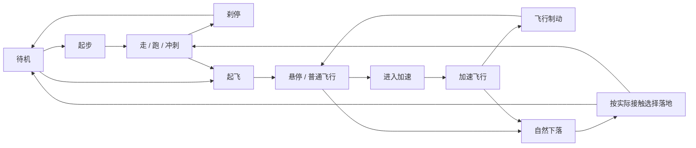

# 祖国人动作风格、制作与衔接计划

日期：2026-10-19。状态：待执行的任务计划。本轮核对了资源、源码与官方工具资料，没有修改运行代码、动作或模型，也没有重新录制当前游戏来判定具体视觉缺陷。用户随后追加超级速度的慢世界、运动拖影和高速撞人血溅要求，已同步需求与协作文档；离线人体编辑范围仍是后续采用实施提示词时的有界调整。

直接启动后续任务使用 [实施提示词](HOMELANDER_ANIMATION_START_PROMPT.txt)。当前角色事实以 [角色接入记录](HOMELANDER_INTEGRATION.md)、当前源码及实际运行资源为准；旧通过记录不等于新风格已认可。

## 1. 要交付什么

把现有祖国人做成动作气质统一、操作响应清楚、过渡自然的可玩角色。分别解决四类问题：

| 问题 | 如何判断 | 对应工作 |
|---|---|---|
| 动作本身不合角色 | 单独原速播放就显得紧张、夸张、像普通格斗选手 | 换来源，或在允许范围内离线改造姿态与节奏 |
| 适配或蒙皮出错 | 源动作正常，主角却耸肩、折腕、扭胯、拉扯 | 检查绑定姿态、骨骼映射、比例、约束和导出 |
| 动作之间生硬 | 单段正常，切换时突然变姿势、脚错相或停一拍 | 接触相位、过渡片段、分层权重、状态切换 |
| 动作与游戏运动不一致 | 步频与位移不符、落地后升高、命中早于出拳 | 速度标定、物理接触、命中事件和统一游戏时间 |

AI 承担盘点、制作、重建、接入、录制和缺陷修复。用户主要做两次审看：小样的角色气质，以及最终连续游玩。不能承诺 AI 无需任何审美反馈就会一次做对。

## 2. 风格基准

以下是本任务建议采用的美术方向，尚不是用户已逐帧认可的影视复刻标准：**克制、傲慢、从容，力量很大但不显得费力。**

| 场景 | 应有的表现 | 应避免的表现 |
|---|---|---|
| 待机、慢走 | 上身挺拔但有呼吸与重心变化，肩颈放松，摆臂节制 | 军姿僵直、反复大幅喘气、永久战斗架势 |
| 悬停 | 直立稳定、四肢自然垂放，轻微身体运动，披风随气流反应 | 手臂折在胸前、双肩耸起、反复蹬腿 |
| 加速飞行 | 姿态随加速进入前倾，轮廓明确，减速后恢复直立 | 角色瞬间翻成水平、普通飞行也一直冲刺姿势 |
| 镭射 | 以目光和头部朝向表达压迫感，垂手、叉腰、背手各自清晰 | 发射时突然全身绷紧、移动时腿被静态姿势锁住 |
| 拳击 | 短而明确的准备，清楚的接触点，力量释放后从容收势 | 所有攻击都大幅蓄力、身体软塌、拳头出到一半就淡掉 |
| 落地 | 轻落地利落恢复；重落地有受力和收势，可比较直立落地与现有三点式 | 每次小落差都夸张跪地、接地后再播放空中下降 |

先让 AI 提供“较克制”和“压迫感更强”两版短小样。变化应能说清楚，例如准备幅度、重心、出手与收势节奏；不要只提供两张静态截图。

参考材料分两种：姿势图表达轮廓；视频表达时序、重心和接触。单张图不能决定完整动作。可使用用户合法提供的参考或可访问的公开演示进行观察，保留出处与时间点；不把影视或其他游戏的动作数据直接提取进项目。

## 3. 当前已经有什么

主角是 68 骨骼、五指蒙皮的 ARP 模型，运行文件 `public/assets/human/homelander.glb`。现有 18 个片段中，17 个独立片段参与当前主要行为；`slam` 保存在包内，Q 实际复用 `land`。

| 分类 | 当前片段 | 数量 | 本轮处理原则 |
|---|---|---:|---|
| 地面 | `idle`、`walk`、`jog`、`sprint` | 4 | 逐段审查气质、接触相位和实际速度，不按文件名判断是否合适 |
| 飞行 | `takeoff`、`hover`、`fly` | 3 | 普通飞行主要用 hover，加速用 fly；优先统一这三段风格 |
| 跳跃与着陆 | `jump_start`、`fall`、`jump_land`、`land` | 4 | 保留真实物理触地、普通与重落地的区别 |
| 攻击 | `casual_attack`、`punch`、`combo_a`、`combo_b` | 4 | 保留 E／右键／R／T 和各自命中次数，逐招审查准备、接触、收势 |
| 镭射姿势 | `laser_hip`、`laser_back` | 2 | 当前为约一帧的姿势，默认垂手复用 idle；需要检查进出姿势 |
| 包内备用 | `slam` | 1 | 本轮不为了片段数量启用它；Q 仍共用 land，除非后续明确决定拆分 |

现有实现已经具备移动动作归一化时间相位衔接、平滑权重、跑动攻击上下身分层、命中标记、0.12 秒攻击输入缓存和插值时钟。归一化时间尚不等于左右脚接触事件已经对齐，分层也不等于脚步自然。当前不是从零搭动画系统。

主要代码抓手：`PersonVisual.ts:102` 的 play、`:142` 的 blendPunch、`:198` 的 update；`Player.ts:344` 的 animate；`config.ts:39` 的 animation 与 `:65` 的 heroAttacks。当前淡化为地面 0.24 秒、飞行 0.34 秒；数值是基线，不是所有过渡的最佳答案。

## 4. 一共需要哪些动作

**保留并审查上述 17 个现有动作类别，优先补足下面 12 个过渡职责，形成约 29 段的候选动作库。** 这不是要求从零重做 29 段，也不是必须为每条状态边制作一个片段；现有素材重用后若已自然，就不新增。备用 slam 不计入这 29 段。

| 编号 | 建议片段名 | 用途与验收重点 | 优先级 |
|---|---|---|---|
| N01–02 | `jog_start_l/r` | 从待机进入跑步，分别适应左右支撑脚；输入后及时响应 | 第二批 |
| N03–04 | `jog_stop_l/r` | 跑步松键时收住步态，避免滑着切回待机 | 第二批 |
| N05–06 | `turn_l/r` | 近静止左右转身，脚与身体共同转；不能原地脚底旋磨 | 第二批 |
| N07 | `hover_to_fly` | 从直立悬停进入加速飞行 | 第一批 |
| N08 | `fly_to_hover` | 松开加速或方向后制动并恢复直立 | 第一批 |
| N09–10 | `laser_hip_enter/exit` | 手到腰、离开腰的自然过渡 | 第三批 |
| N11–12 | `laser_back_enter/exit` | 双手到背后、回到垂手的自然过渡 | 第三批 |

需要左右起停版本，是因为循环可能在任一只脚支撑时被打断。N05–06 的源动作角度要实测；大角度转身、跑动急转、冲刺起停、上升下降或空中攻击若仍有明确缺陷，再补专用变体，单列数量和证据。不能把同一段慢速刹停强套到 24 米/秒。

暂不增加嘲讽表演、抓取投掷、闪避、玩家受伤死亡、复杂战斗姿态树，也不要求八方向跑步。当前角色会朝运动方向转身；只有未来决定移动与瞄准朝向长期分离，才需要完整的侧移/倒退动作组。

## 5. 微调与新建的工具路径

优先顺序：**审查并重用现有动作 → 选择更合适且许可明确的来源 → ARP 正式适配 → 必要的离线艺术编辑 → 接入 GLB → 实机验证。**

当前 AGENT/AGENTS 规则禁止手工人体关键帧与关节姿态补丁。因此，两个范围必须明确区分：

1. **现行范围即可做：** 来源替换、正规重定向、片段裁剪与时间重排、接触相位标注、运行时分层和混合。它能改善不少生硬问题，但未必能创造独特人体表演。
2. **建议在正式启动制作时明确增加的范围：** 允许 AI 在原 ARP 控制骨架上，通过 Blender 的姿势资产、NLA 编辑、IK/约束等成熟离线工作流微调或新建清单内的姿势与过渡，保存编辑层并烘焙导出。新的实施提示词已经写明这条有界调整；用户采用它启动时才作为该实施任务的要求。本规划没有直接修改旧规则。

即使允许第二项，也不能把 `bpy` 中逐关节填角度或浏览器加姿态偏置包装成“用了 Blender”。必须有明确参考、可编辑控制器/约束、修改记录、完整身体对照与游戏内结果。成熟工具负责约束与求解，不自动保证表演自然。

现有主链路保持 Blender + Auto-Rig Pro Remap / Universal GLTF。ARP 官方支持重定向后校正及 NLA 附加编辑；具体功能要按本机版本验证。[ARP Remap 官方文档](https://lucky3d.fr/auto-rig-pro/doc/remap_doc.html)

Blender 可把约束、驱动器和修改器的最终动画烘焙为关键帧；烘焙只固化结果，仍要检查接触和蒙皮。[Blender Bake Action](https://docs.blender.org/manual/id/3.5/editors/nla/editing.html) 动作导出受 Action/NLA 模式影响，参数要在本机版本与现有 ARP 导出器上核验。[Blender glTF 导出说明](https://docs.blender.org/manual/uk/4.4/addons/import_export/scene_gltf2.html)

Cascadeur 仅为可选工具研究项：AutoPhysics 会给出物理调整建议，不保证角色气质；超人悬浮也不应机械套用普通人的弹道约束。本任务不以安装、账号或付费服务为依赖。[Cascadeur AutoPhysics](https://cascadeur.com/help/tools/physics_tools/autophysics)

原始源动作、编辑后的 Action、最终 GLB 分开保存。若编辑了动作，必须据实标注 authored/edited 状态，更新 `keyframesAuthoredHere:false` 等旧元数据及测试假设；不能让已编辑的新动作继续冒充“原始采样逐字节未变”。未改动作仍应保留原样验证。

## 6. 怎样流畅组合

保持现有物理状态机，由动画层表达细节。起步、制动等首先是表现阶段，不应自动扩成会改变玩法的物理模式。

图只展示主要循环；跳跃、攻击、镭射与 Q 按下表接入，并继续覆盖空中 F/Q 接管和暂停。

| 组合 | 组合方式与规则 |
|---|---|
| idle ↔ walk/jog/sprint | 起停优先按当前支撑脚选择；移动循环按左右脚接触事件对齐，不只对齐百分比 |
| walk ↔ jog ↔ sprint | 同步接触相位并保留速度变化；在切换阈值处检查抖动，必要时加小范围迟滞 |
| 原地转向 / 急转 | 近静止用转身片段；运动中按实际转弯与足部支撑检查，不能只让整模型瞬转 |
| ground → takeoff → hover | 保留约 0.65 秒起飞基线；准备、离地和直立悬停姿态连贯，低顶不得穿透 |
| hover ↔ fly | 速度、加速度和方向触发表现阶段；不要仅用速度阈值让身体在直立/水平间反复切换 |
| jump_start → fall → jump_land | 物理决定起跳、顶点和接地；不把完整起跳素材挤进很短时长后仍认为节奏合格 |
| fall → land | 保留自然落差 6 米门槛与落点计算；目前接触点 0.45 秒只适用于现有 land，换素材必须重标 |
| Q → 接地 → land 收势 | 当前空中保持接触姿势，接地只结算一次；先验收这一方案，证据不足不拆新招式 |
| 移动 + 拳击 | 复用现有上下身分层，但逐招检查扭腰/重心；依赖脚步发力的攻击不能只裁出上半身就宣称正确 |
| 静止 + 拳击 | 保留准备、接触、完整收势，再回当时有效的基础状态；R/T 的多次命中继续对齐动作 |
| 静止 + 镭射 | 已选姿势进入 → 持续保持 → 松开退出；V 快切时从当前姿态混合，不强制跳回 T-pose 或 idle 首帧 |
| 移动/飞行 + 镭射 | 保留对应移动姿态与物理位移，头部/眼睛与准星和遮挡一致；不强套地面叉腰/背手全身静态姿势 |

Three.js 已提供权重、时间与 crossfade/sync 等控制；**脚接触对齐和步幅匹配仍是项目要完成的工作**，不是调用 crossfade 就自动获得。[AnimationAction 官方文档](https://threejs.org/docs/pages/AnimationAction.html)

每个动作记录一张简短合同：来源/许可、循环或一次、in-place、输入姿势、输出姿势、左右接触帧、起跳/触地/命中时点、可打断窗口、允许的分层、播放速度范围、脚底高度。没有事件的动作不硬填事件。新参数集中在 `src/core/config.ts` 或明确的资产构建配置。

淡化先保留当前参数作对照，每条边按实录调整；延长淡化可能只是拖慢操作。移动、镭射和转向不应因新表现片段额外等待；重拳与砸地保留原有动作占用。重拳/砸地暂停镭射，结束且左键仍按住时恢复；砸地收势前不能被 F/重拳打断。跳跃期间不启动拳击，落地收势期间不接受跳跃。不要借动作优化扩大取消权限。

### 单独处理超级速度

`config.ts` 当前 sprint=24 米/秒，跑步倍率上限 1.35；`pack-homelander.mjs:83` 的 sprint baseSpeed=8 米/秒。按元数据计算，8×1.35=10.8，与 24 相差约 2.22 倍。**这是配置关系，不是实测步幅，也不能据此直接报告真实脚底滑移。**

用户追加的表现定义为：**玩家保持灵敏、周围世界进入慢动作，身后留下类似动态模糊的连续运动拖影；高速撞上行人时，行人当场变成血溅与血泥残留，玩家不因这次接触减速。** 参考用户提到的 A-Train 撞击观感，不提取剧集或其他游戏资产。这是已确认的本次增量，覆盖旧版“不做慢动作”及该情形下“只用少量血液/布娃娃”的限制。

慢世界增强相对速度感，但不会自动修复足部滑移。先测实际片段的自然步幅/周期，保留 24 米/秒和 1.35 上限作为首轮对照；若仍不自然，提供保留高速与降低玩家实际速度、更多依靠世界减速的 A/B，说明实际速度与相对速度，再由用户取舍。不能暗改速度、硬拉腿长或用运动拖影遮住滑步。

#### 超级速度的表现与时间规则

- 使用现有 Shift + 方向输入。默认沿用超级速度既有的地面冲刺和空中加速范围，先把地面冲刺做成样板，再验证飞行；无移动输入或松开 Shift 时退出。普通移动、悬停不触发，不增加能量、时限或冷却。
- 世界倍率建议首轮为 0.15，约 0.15 玩家秒进入、0.25 玩家秒恢复，均为待实测的集中配置。倍率表示周围世界每经过 1 秒玩家时间只推进约 0.15 秒，不把玩家当前速度再乘一次倒数。玩家地面 24 米/秒若保留，相对慢世界约为 160 米/世界秒，须据实展示，不能称作自然跑速。
- 玩家输入、移动/重力/跳跃、动作和攻击窗口、镭射伤害 tick、镜头、玩家披风用玩家时间；NPC 移动/动画/决策/射击、车辆、倒地身体、坠落物、碎片、烟尘/血液等世界效果用世界时间。静态建筑不需要“减速”。
- 玩家命中即时结算；NPC 补充/撤离、追捕消退和世界效果寿命用世界时间，UI 立即反映结果。接触保护与攻击缓存用玩家时间；不能混用时间戳导致重复命中或伤害 tick 堆积。没有新增冷却。
- 血溅在撞击当步生成，随后运动、落下和消退属于慢世界；运动拖影属于玩家速度表现，采样与消退用玩家时间。玩家披风仍跟随玩家运动和相对气流，不能随世界减速后被甩长。
- 暂停冻结两个模拟时间域及运动拖影，不继续消退或补伤害；清持续输入。恢复时根据已清空的输入退出超速，不能残留世界减速。重置同时恢复倍率 1、时钟、碰撞过滤与所有临时效果。

#### 工程先验证时间，再接入画面

当前 `Game.step()` 给玩家、NPC、物理、Combat 和 Effects 同一固定步；玩家和物体共用一个 Rapier world（`Game.ts:190–202`）。本任务因此新增世界时间控制工作，不能把它当成单独的跑步素材替换。

先做最小验证：输入/玩家模拟以固定玩家步推进；世界逻辑、动画、插值和动态物理按世界步推进。记录两套累计时间及每个系统归属。共享物理世界中的运动学玩家、慢速动态刚体、推车冲量、坡面/屋顶接触和切换倍率必须实测后确定实现方式；不能直接缩所有 dt，也不能只慢 NPC 动画，或反复放大玩家速度来抵消全局减速。

每个积分/计时路径只缩放一次。NPC 运动学位移按世界 dt 计算、同时物理世界采用对应 timestep，并不天然等于重复缩放；要沿真实调用链检查，特别防止先传入 worldDt 后又乘 worldScale。保留原有 Rapier 查询过滤回调只比较句柄和 JS 元数据的规则。未经最小验证，不预先拆成多个物理世界或搭通用时间线框架。

#### 连续运动拖影（用户已澄清）

用户进一步澄清：这里是**类似动态模糊的连续运动拖影**。主角身后沿刚经过的真实运动路径形成半透明、软边、逐渐变淡的拉伸痕迹；不出现一个个可辨认的人形或定格姿势。主角本体、镜头和瞄准保持清楚，强度与长度随实际移动速度变化，停止后迅速消退。

优先做角色局部运动模糊或贴合真实路径的连续软边拖尾小样，按游戏画面与成本确定实现；不预设必须上全屏后处理。不复制角色、骨架、蒙皮或披风姿态，也不保留之前提出的“每隔一段时间生成一个人物”的方案。不能把效果做成均匀排开的影子、硬边色带或一串粒子点；跟随镜头下角色在屏幕中央时也应有拖影，不能只依赖屏幕位置变化，原地转动镜头则不应凭空产生超速拖影。

若采用路径拖尾，首轮建议历史窗口不超过 0.15 玩家秒、可见长度上限约 3 米、一个连续带状网格最多 32 段；这是待实测的初始预算。弯道跟随真实路径而非一根固定直线，传送/重置切断历史，无移动时只消退不新增；如采用局部模糊后处理，另记录采样与像素成本。

拖影按玩家时间采样和消退，暂停冻结、重置清空；无碰撞、无命中、无独立动作或布料模拟，资源复用且数量/历史有上限。检查深度遮挡与透明排序，不穿墙显示，不把整幅世界或准星糊掉。实际跑动、转弯、急停和高速飞行都录制原速画面验收。

#### 高速撞人

用户要求以行人样板实现。默认将同类活体人形 NPC（平民、警察、士兵）统一处理，避免同样的人体因角色类型出现完全不同的高速阻挡；地面样板先验收平民。

只有超速激活且实际玩家速度达到高速接触门槛时才触发，首轮沿用 18 米/玩家秒；慢世界不能把普通走动虚算成高速。命中后立即停止目标 AI/攻击并注销人形及其碰撞体，以定向血溅和落在实际支撑面上的不规则血泊/血泥残留取代完整身体；该死亡方式不生成新的完整布娃娃。其他死亡方式沿用现状，不扩展为通用肢解或器官系统。

当前先由角色控制器算出受阻移动，再结算 contact，且只有已毁 prop/panel 请求重算；行人仍会挡人（`Player.ts:252–281`、`Combat.ts:173–187`）。实施应在本步可到达路径上收集高速人形接触，用有体积的连续扫掠与实体去重，完成一次性死亡/移除，再得到完整剩余移动；不要只删可见模型，也不要等已经丢失位移后才补效果。

可到达路径必须被完整墙体、车辆等当前有效障碍截断，按接触先后和破坏后的真实通路处理；不能扫出全路径后提前杀死墙后的人。死亡、击杀/追捕计分、血溅只发生一次，运动拖影不参加检测，已死目标不能再次被结算。撞人不改变玩家速度，也不丢失应走的位移；墙体、车辆及边界仍按各自规则阻挡。多名行人连续接触也要成立。

血溅与血泥必须有可见方向、空间范围和地面残留，不能只把 NPC 隐藏或仍复用当前 4 个小红粒子冒充完成。效果统一池化/限额/清理，支持屋顶和非零高度，不穿完整墙体投射血迹；暂停/重置和资源释放完整。当前只有短寿命血色粒子，尚无血泊/贴花或连续运动拖影系统（`Effects.ts:135–153`）。

#### 超速子任务与专项验收

在 A2 中按 S0 → S1 → S2 → S3 执行：S0 验证双时间域及共享物理；S1 接入进入/退出、慢世界和玩家动作；S2 连续运动拖影；S3 非阻挡高速人形死亡、血溅残留与全链路验收。S0 失败时先解决时间/物理问题，不能用动画或粒子掩盖。它们不需要新增人体动作类别；仍先沿用约 29 段候选动作规模。

验收至少包括：同样玩家输入下，0.15 倍世界中的 NPC 位移与自由落体模拟时间吻合，玩家轨迹不受时间缩放意外拖慢；进入/退出无位置或动态刚体速度突变，60/120/144 Hz 与不均匀帧间隔结果一致。自由落体应与正常世界仅推进 0.15 倍时间的轨迹比较，不能把下落距离简单乘 0.15。

对比同路径无行人与有行人的玩家速度/实际位移，确认当步无卡顿或截断；覆盖一个人、连续多人、墙前/墙后、车前/车后、边缘擦过、低速拒绝、已死目标、屋顶、转向、超速退出、暂停/恢复和三次重置。记录击杀/热度/效果次数与 NPC 注销，确认 NPC 补充预算正确。血液池和拖影历史在慢世界长时间使用时仍有上限。录制约 15 秒同镜头演示：NPC 行走与物体坠落 → 超速/运动拖影 → 连续撞人 → 退出恢复。

## 7. AI 执行阶段

| 阶段 | 工作 | 必须交付 | 通过后做什么 |
|---|---|---|---|
| A0 基线 | 录制全部 17 个在用动作及关键组合，定位具体时间点；区分素材/适配/衔接/运动问题 | 动作台账、当前版本摘要、原速多角度基线、具体缺陷清单 | 自动进入 A1 |
| A1 风格小样 | 对 idle、hover、fly 做克制/较强压迫感对照；做完整起落链小样 | 20–40 秒原速游戏录像；idle→takeoff→hover→fly→制动→hover→fall/land；标注哪些环节仍复用旧片段 | 用户一次确认风格，再批量扩展 |
| A2 地面与超级速度 | 走跑风格、左右起停/转身，依 S0–S3 完成慢世界、运动拖影和高速撞人 | 起停/转向/Shift 实机视频、接触/滑移和双时间域数据、连续撞人/物体坠落演示 | 修复后进入 A3 |
| A3 能力 | 四种攻击、三种镭射姿态及进出、跑动/空中混合、Q | 每招接触/收势对照，连招/镭射切换录像，事件验证 | 修复后进入 A4 |
| A4 整合验收 | 全部过渡、真实输入、暂停/重置、源资产与生产启动 | 完整演示、逐项结果、可重建源工程/配置/许可和已知限制 | 用户最终体验验收 |

A1 把三个动作的风格对照与按建议方向制作的完整链条一起交付，一次审看；不要把尚未制作的飞行制动伪称完成。风格已认可后，不为每个参数反复询问。阶段内可做最多两轮有明确差异的修正；仍不收敛就报告原因和候选取舍，避免无目标反复生成。

先探索、再制作、再验证。重型独立盘点/审查按仓库规则派只读探子，全部相关探子终态后再推进；文件修改与最终验收由主代理负责。Blender 构建、GPU 录制和浏览器性能检查串行。城市任务和角色任务不要同时改共享配置、源模型或跑 GPU 测试。

## 8. 怎样验收

### 8.1 用户只需重点看三件事

1. **像这个角色：** 原速下是否从容、有压迫感，还是紧张、轻飘、像体操/通用格斗角色？重点看肩颈、手臂、骨盆、手掌与脚，不仅看披风。
2. **连续时自然：** 起停、转身、加速制动、攻击收势是否有身体过程？脚是否滑，是否突然跳姿或陷入默认姿势？
3. **操作仍顺手：** 临时反向、松键、F/Q、攻击接镭射、暂停后继续，是否及时且可预测？

可给“角色气质、接触/重心、衔接、操作响应”各 1–5 分，建议每项至少 4 分且无明显硬缺陷。分数辅助比较，不能用平均分抵消某项失真。

每段录像以原速为主，辅以慢放。提供正面、侧面、背面和实际第三人称；固定光照、镜头、速度、输入脚本与基线对照。单段循环至少三次；单张截图、源动画预览或 Blender 渲染均不能替代实机连续画面。默认保留城市与 NPC，必要时另设诊断净场并明确标注。

### 8.2 技术检查和证据

| 项目 | 标准 |
|---|---|
| 来源与复建 | 输入、编辑层、控制骨架、工具版本、脚本/参数、GLB 与哈希可追溯；来源许可保留，edited 动作如实标记 |
| 骨架与蒙皮 | 完整 68 骨骼、肩/肘/腕、五指、髋/膝/踝/脚趾和实际蒙皮检查；身体无明显折叠、拉伸、持续穿模，披风单独检查 |
| 连续性 | 保留现有 120 Hz、0.12 米局部关节/蒙皮连续性门槛和测试坐标定义，不放宽；增加循环缝和姿态速度变化观察。此阈值只防明显跳变，不证明动作好看 |
| 脚接触 | 给左右支撑阶段打标，测脚掌/脚趾在世界空间相对支撑面的漂移。建议普通步行/跑步完整支撑段累计水平漂移先以 ≤5 厘米为目标，报告最大值与分布；先校准标记，不能把摆动或腾空算作滑步 |
| 触地 | 复用当前物理脚底和接触检查；无接地后上弹或重复空中下降。新素材重新测接触点，不能照抄旧 0.45 秒 |
| 高速 | 24 米/秒单列实际步频、滑移和原速画面，不以普通跑合格外推；5 厘米为新建议目标，尚未证明高速方案可达 |
| 慢世界 | 玩家保持响应；NPC、动态刚体、坠落、血液、碎片按世界时间一致推进；比较等模拟时间轨迹，进出/暂停/重置无速度突变或残留 |
| 运动拖影与撞人 | 拖影连续、软边拉伸且历史/资源受限，没有离散人形；高速撞人当步无减速或丢位移，血溅/残留明确，死亡/计分一次，墙车后的目标不提前命中 |
| 响应与时序 | 输入到物理响应不增加强制等待；记录新旧输入→动作、命中→伤害时点。拳头/肘部命中、R 四次/T 两次、Q 接地一次，与画面一致 |
| 打断与残留 | 快速切换、同名攻击连续播放、V 循环、松开左键、攻击后恢复，层权重无残留，不误入 idle 或绑定姿势 |
| 生命周期 | 暂停冻结动画/事件/披风且清持续输入；三次重置恢复基线，不重复伤害、不污染其他角色共享资源 |
| 运行 | 不同刷新率和不均匀帧间隔、开发/生产启动、当前功能测试通过；记录资源体积和动画更新成本变化 |

5 厘米是本计划新增的工程目标，需在 A0 建立正确接触标记后验证；不能声称现有测试已满足。新指标失败时记录原因，不能自动放宽。无敌主角仍不新增普通受伤/死亡动作。

必测序列：

- 待机→走/跑→Shift→松开→立即反向→停下，左右转向与急转。
- 超速中的 NPC 行走与自由落体对照、拖影连续性、转弯与急停消退、连续撞人不减速、完整墙车遮挡及退出恢复。
- 地面起跳→普通落地→继续跑；低顶/屋顶/平台边缘；空中 F 悬停及 Q。
- 地面起飞→悬停→普通飞行→加速→急停→反向→升降→F 自然下落。
- 低/高自然落差及屋顶落点；低/高 Q；落地收势中的拒绝输入。
- 站立、跑步、悬停、加速飞行中分别使用右键/E/R/T；连续同招、交替连招、末段缓存。
- 静止左键+V 三姿势、松开再按、切换中移动、移动中停止、拳击结束恢复镭射。
- 上述关键阶段暂停/继续、失焦清输入及三次重置；60/120/144 Hz 和不均匀间隔。

复用 `native-character-check.mjs`、`character-motion-check.mjs`、`running-continuity.mjs`、`character-game-check.mjs`、`quality-acceptance.mjs`；按范围追加 `flight-transitions.mjs`、`jump-landing-check.mjs`、`scene-motion-check.mjs`、`attack-transitions.mjs`、`final-smoke.mjs` 及 `tests/player-flight.test.ts`。地面起停区间和足底漂移是本轮需要补的检查；现有 running 检查会排除部分松键区间。

类型检查、相关测试和 build 必须执行。正常运行无需 Blender；从保留的输入重建则验证离线链路。最终交付若修改资产来源/打包/依赖，在干净导出副本复核安装、测试和构建。性能按改动测量；全面长测采用原实施计划的目标与环境要求，不拿历史数据补本轮结果；未测项如实列出。

## 9. 交付物与继续工作的方式

建议后续实施产出：

- `docs/HOMELANDER_ANIMATION_REVIEW.md`：当前版本/环境、逐动作决定、问题时间点、过渡矩阵、实际验证与未测项。
- `.asset-source/homelander/` 中按现有白名单归档必要原始输入、可编辑 Action/工程、来源与构建配置；不提交插件或凭据。
- 更新既有适配/打包流程、运行 GLB、来源摘要、素材账本与进度；新增参数避免散落。
- `.artifacts/animation-style/` 中的基线/A-B/最终实机 MP4、多视角图、接触与事件数据；这类批量证据默认不进 Git。

每次恢复任务先读审查文档的当前状态，只处理已记录缺陷和下一阶段。给 AI 的修正反馈使用“片段/过渡 + 时间点 + 可观察问题 + 目标”的格式，例如：“fly→hover，12.4–12.8 秒，手臂先跳回垂手而躯干仍水平；希望制动过程肩臂与身体一起恢复直立，保留即时减速”。

不要只反馈“再自然一点”，也不要让 AI 用一次性截图、自评分或测试绿灯替用户确认角色气质。
